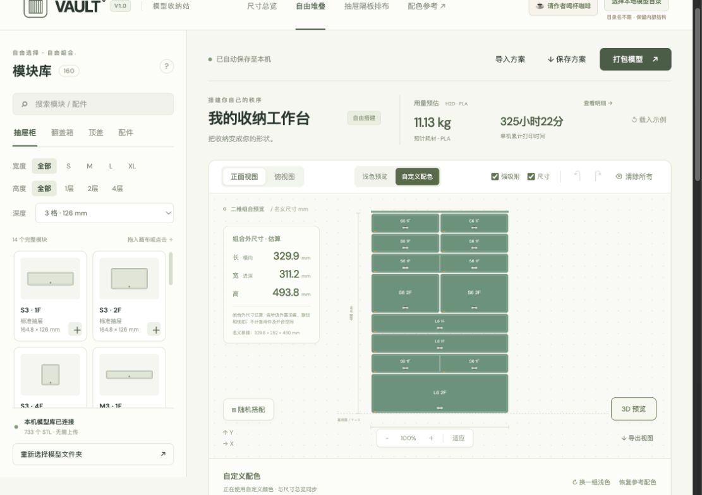
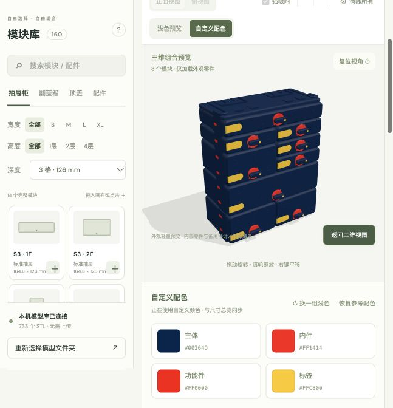
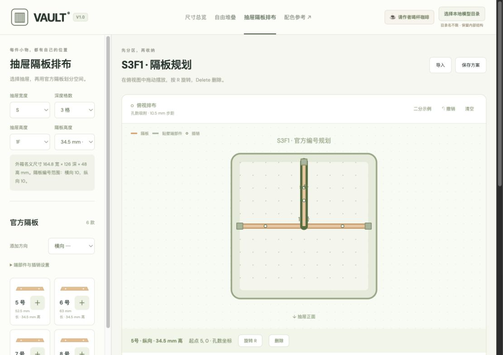

# VAULT 收纳工作台

把箱子选型、收纳柜堆叠、抽屉分区和打印文件整理，放在同一个浏览器工作台里。

网站制作：**@液体香胶** · 原模型与装配说明：**VAULT / USSA DESIGN**

<!-- release-status:start -->
**当前版本：V1.2** · **更新时间：2026-10-31 21:32:48（北京时间）**
<!-- release-status:end -->

[下载项目](https://github.com/jingv006/VAULT_na/archive/refs/heads/main.zip) · [完整更新记录](CHANGELOG.md) · [使用说明](docs/USAGE.md)

## 核心功能

| 功能 | 可以做什么 |
| --- | --- |
| 尺寸总览 | 筛选 160 种模块配方，查看零件、数量、配色、外尺寸与内腔参考。 |
| 自由堆叠 | 拖动插层、强吸附、底座规则检查，支持随机搭配、撤销与方案保存。 |
| 三维预览 | 查看真实模型装配、爆炸与开合；组合外观预览和自定义配色同步。 |
| 抽屉隔板排布 | 按抽屉规格摆放官方隔板，生成隔板、连接件与插销清单。 |
| 打印规划 | 汇总 H2D 耗材与时间预估，检查常见机型或自定义打印机的逐件尺寸适配。 |
| 文件打包 | 合并同名 STL，或按模块输出预分色整合 3MF；`print-N` 标注打印份数或套数。 |

**733 个 STL 文件索引 · 160 种模块配方 · 本地读取模型，无需上传**

## 功能展示

<table>
<tr>
<td width="50%"><strong>二维堆叠与组合尺寸</strong><br></td>
<td width="50%"><strong>三维组合与自由配色</strong><br></td>
</tr>
<tr>
<td width="50%"><strong>官方抽屉隔板排布</strong><br></td>
<td width="50%"><strong>按模块整理 3MF</strong><br></td>
</tr>
</table>

## 开始使用

1. 下载并解压项目；**仓库不包含原始 STL 模型**，请准备自己的模型库。
2. 本机服务使用与项目同级的 `261021_VAULT_USSA_S` 模型目录，保留内部文件结构。
3. Mac 双击 `启动工作台.command`；也可在项目目录运行：

```sh
python3 server.py --port 8766 --open
```

基础功能需要 Python 3.9+；三维与 3MF 转换需要 NumPy。其他平台的依赖、浏览器目录模式和详细操作见[使用说明](docs/USAGE.md)。

方案保存在当前浏览器，可另存 JSON。耗材/时间采用 H2D 切片基准；装配外尺寸为闭合预览估算，最终打印以切片器核对为准。

## 版本迭代

<!-- release-history:start -->
| 版本 | 发布时间（北京时间） | 更新内容 |
| --- | --- | --- |
| V1.2 | 2026-10-31 21:32:48 | 精简 GitHub 项目首页，补充核心功能展示与带时间戳的自动版本记录 |
| V1.1 | 2026-10-31 20:20:02 | 抽屉隔板排布、实物尺寸校验与整合 3MF 打包 |
| V1.0 | 2026-10-29 14:28:55 | VAULT 工作台首个编号版本 |

[查看全部版本记录 →](CHANGELOG.md)
<!-- release-history:end -->

时间统一使用 **北京时间（UTC+08:00）**。后续上传会自动递增版本号，并同步首页、网页版本标记、更新内容和时间戳。
